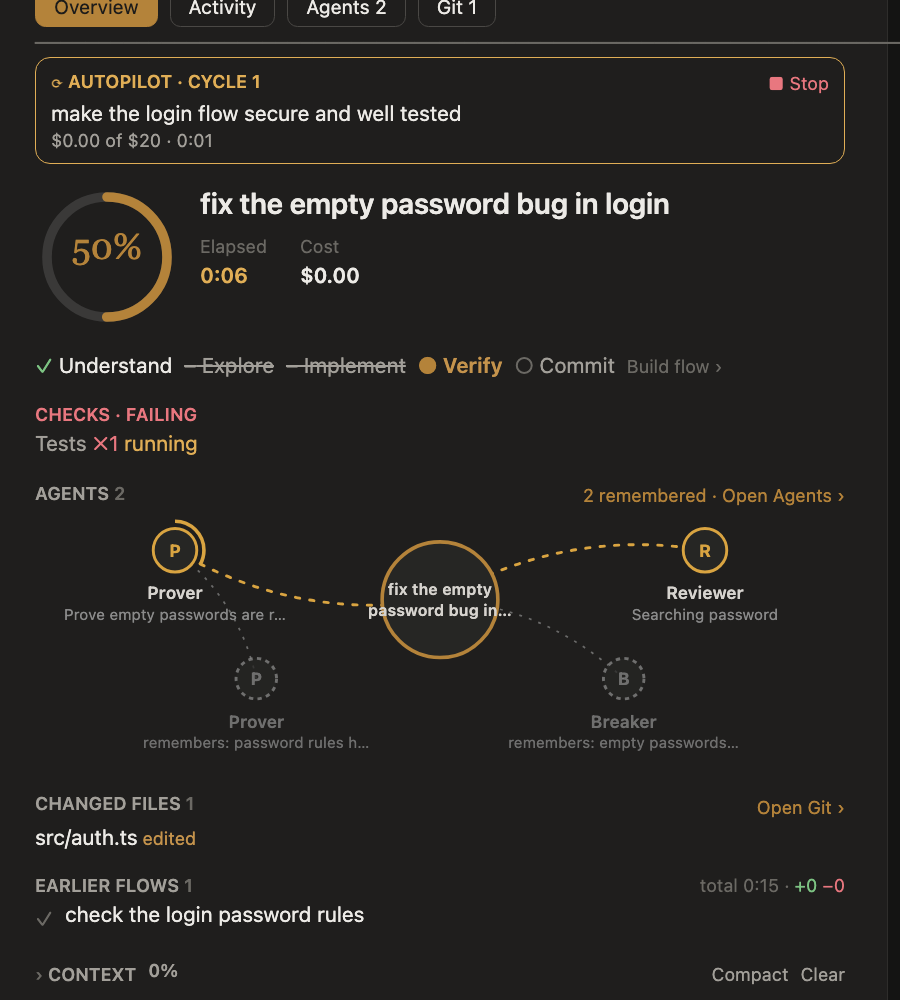

# Cockpit for Claude Code

[](https://github.com/dhirajnikam/mod-plugin/actions/workflows/ci.yml)
[](LICENSE)

**See what Claude Code is doing, and steer it.** Cockpit is a Claude Code mod: a side pane and a band around the
prompt that show each task's progress, the agents at work and what they found, your codebase as a map, and git, with
the controls to act on all of it. It can also work on a goal by itself, cycle after cycle, until a panel of judges
agrees it is done.



*A preview of the Overview, drawn from the desktop pane.*

## Install

Requires Claude Code 2.1.275 or later. At the prompt of a Claude Code session, type:

```
/plugin install cockpit --marketplace dhirajnikam/mod-plugin
```

Answer `y` to add this repository as a marketplace, then pick a scope: you everywhere, or one project. Cockpit loads
at once; `/cockpit` opens its pane. Later versions arrive with `claude plugin update cockpit`.

## A tour

| Tab | What you see and do |
|---|---|
| [**Overview**](docs/overview.md) | The task's progress ring and steps, checks that turn red when something fails, the agents at work as a neural view with what is remembered from similar tasks, changed files, context with Compact and Clear, and the judges' decisions |
| [**Activity**](docs/activity.md) | A live feed of every file read, edited or searched; your codebase's features as a map, with what is being worked on lit; the impact of a change |
| [**Agents**](docs/agents.md) | Build, Verify and Review pipelines; six experts and agents you describe in plain words; each agent's progress, who started it, and two testers on every change |
| [**Git**](docs/git.md) | The next commit, written from the diff; commit modes from manual to automatic; a git graph of every branch |
| [**Rules**](docs/rules.md) | The hooks, permission rules and `CLAUDE.md` instructions of the repository or of you, to add, edit and delete |

Around the prompt: a Progress and Context band, a spinner that says what is happening, and tool activity as cards in
the chat ([Focus](docs/overview.md#focus-colours-and-live-figures) hides them).

- **[Autopilot](docs/autopilot.md)**: give it a goal, and an optional budget and time limit. Claude writes a roadmap of
  checkable milestones and works through them, testing each, until the judges agree every one is done. It pauses for
  you on anything hard to undo.
- **[Judges](docs/judges.md)**: when Claude asks you something, a panel of 3 to 9 model judges, each with its own point
  of view, votes. In Auto mode a clear winner answers; anything that publishes, pushes, deletes or touches settings
  comes to you.

## Commands

| Command | Does |
|---|---|
| `/cockpit` | open the pane |
| `/cockpit tab <overview\|files\|agents\|git\|rules>` | open a tab |
| `/cockpit autopilot [$budget] [hours h] <goal>` | work on a goal until the judges agree it is done; `stop`, `resume` |
| `/cockpit run <agents> [-- task]` | run those agents at once |
| `/cockpit test` | run the Verify pipeline now |
| `/cockpit mode <auto\|ask\|off>` | the judges decide, advise, or stay off |
| `/cockpit flow <plan\|task\|build\|docs\|check\|answer>` | put the current task on another flow |
| `/cockpit focus [on\|off]` | hide or show Claude's tool activity in the chat |
| `/cockpit theme <auto\|paper\|white\|black\|solarized\|nord>` | switch the theme |

## Privacy and cost

- Cockpit keeps its history and codebase memory in a `.cockpit/` folder at the top of each repository, with its own
  `.gitignore`, so nothing in it is ever committed. It stores no credentials.
- It makes small model calls: one per prompt for its steps, one for each commit message, and a few per decision for the
  judges (`/cockpit mode off` stops those). Testing each agent's work starts two subagents after any agent run that
  changes files (off in the Agents tab).
- Push, pull requests and Verify after each turn are off until you turn them on. Before a push it switches gh to the
  account you chose, which changes the active GitHub account on your machine.
- Plugins your organization manages may run before Cockpit and skip some of its hooks; the rest keeps working.

The details: [Privacy and cost](docs/privacy.md) and the [security policy](SECURITY.md).

## Develop

```sh
./dev.sh        # start Claude Code with Cockpit loaded from this checkout (dev.cmd on Windows)
```

Saving a file under `cockpit/hooks/` reloads the mod when the turn ends. The checks, the code's layout and how to write
a test are in [CONTRIBUTING.md](CONTRIBUTING.md); every change is listed in [CHANGELOG.md](CHANGELOG.md).

Also here: [`ui-template/`](ui-template), a small earlier mod (a clean spinner and a mode · model · effort line; load
only one of it and Cockpit at a time), and [`design/`](design), the "Powerhouse Mod v2" design Cockpit is built from.

## License

[MIT](LICENSE)
