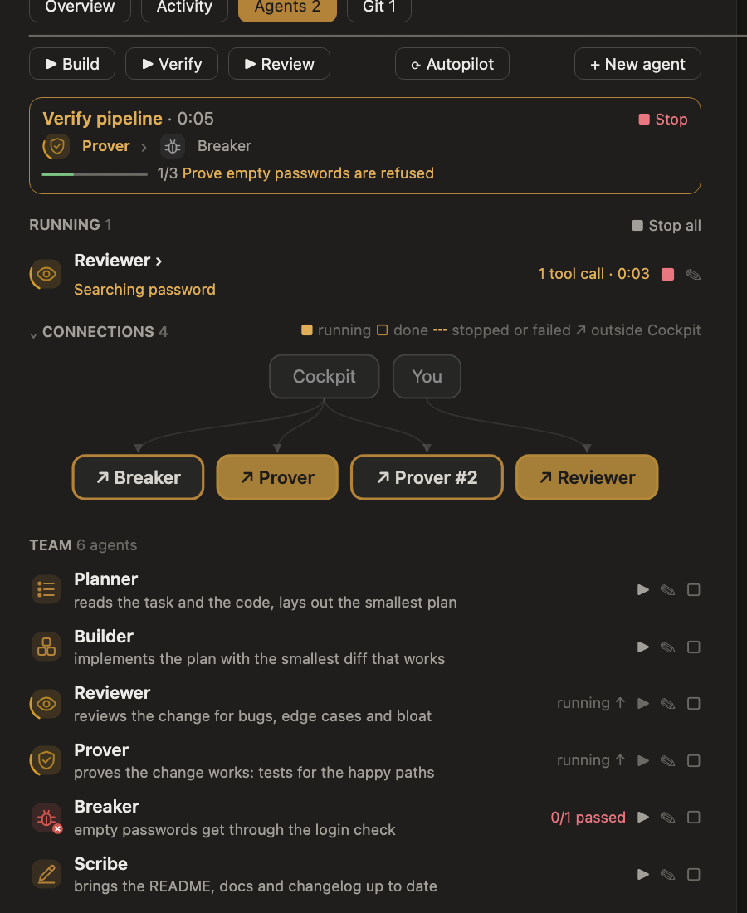

# Agents tab, the experts and agent memory

Start, stop and follow subagents, and read what each found. Each run shows in one place.

*A preview drawn from the desktop pane; the app's own spacing differs slightly.*

## The tab, from top to bottom

- **Build, Verify, Review**, **⟳ Autopilot** and **+ New agent** in one row.
- **The running pipeline**, as a card: its experts' icons (the current one turning, a finished one with its result,
  `Prover ✓3/3`), the running step's tracker, the hand-off it carries, and ■ Stop.
- **Running**: every other live run with its tracker (its own task list as a bar, done of all and the task it is on,
  or its current step when it keeps none), its tool calls and time, a red ■ and ✎ (✎ adds your instructions to its brief and runs it again). Its failing test
  cases show under it. Its name opens its cases, report,
  recent steps, who started it, which plugin provides it, and its transcript.
- **Connections**: who started each agent, as a diagram: you, Claude, Cockpit's pipelines, or another agent; a tester
  points at the work it tests; `↗` marks an agent from outside Cockpit (Claude's own types, another plugin's).
- **Team**: the experts and the agents you made, as a launcher: what each is for, ▶ to run it, ✎ to
  run it with your instructions as its task, and a box to tick it for running several at once. A running or finished one points to
  its run (`running ↑`, `done ↓`) instead of repeating it.
- **Finished**: the three newest runs, each with its result (`3/3 passed`, its report), the rest a press away, each with ↻ Restart and ✎; **Clear** empties the list.
  **■ Stop all**, beside Running, stops every live run.
- **Settings**, folded: choose model and effort for me, test each agent's work, Verify after each turn, and **Tell me when work is done**.

## Told when work is done

While the Cockpit pane is not on screen (closed, or behind another tab), each finish sends one
notice through Claude Code's own notification channel (your terminal's notification or bell; a `Notification` hook
sees it too): the main turn ("Claude is done", its task, files and +/−, tests), each agent you or Claude started
(its REPORT line or its tests, and *Bring back ready* for a worktree agent with work to bring back), each pipeline
("Verify finished", passed or this run's first failing case), and, while the autopilot runs, each cycle (its
milestones and spend, and whether the run paused, stopped or is done) instead of the turn. Agents that ran together
send one notice when the last is done, naming each; one you stopped, or a turn you interrupted, sends none. One notice
per finish, never while the pane is on screen; **Tell me when work is done** in Settings
turns them off, and the choice is kept across sessions.

## The experts

Six experts ship with Cockpit: `cockpit:planner`, `builder`, `reviewer`, `prover`, `breaker` and `scribe`. They work
in turn, each handed the task and the REPORT and HANDOFF lines of the experts before it. **Build** runs the planner,
builder, reviewer, Prover, Breaker and scribe; **Verify** runs the Prover (proves the change works) then the Breaker (tries to break it),
whose CASE lines show on their rows and as `tests ✓n/m` in the band; **Review** runs the reviewer.

Every expert, and every agent you make, keeps a short task list (so Cockpit can track it), never commits, pushes or
switches branches (Cockpit handles git) and never writes to `.cockpit/`; the testers keep throwaway scripts in the temp
folder and name any test they leave in the repository.

- **Every agent is tested by two testers**: when an agent's run edits or writes a file (an expert, one you made, or one
  Claude started), the Prover proves it works, then the Breaker tries to break it, both briefed with what that agent
  was asked and reported. Its row shows `+ positive 3/3   − negative 3/4`. A finished run that has not been tested gets
  **± Test**. The testers' own runs say whose work they test ("testing the Builder's work"). A pipeline's steps are
  left to their pipeline, as Build already ends in both testers. **Test each agent's work** in Settings turns this off.
- **+ New agent** makes an agent from a plain description: a model writes its definition (name, when to use it,
  tools, instructions), Cockpit registers it as
  `cockpit:<name>` and keeps it for later sessions. Claude Code dispatches a new type from the next turn on, so if ▶
  right after making one says the type is unknown, send any prompt first. The same form runs a one-off task with any
  agent type: the built-ins, the experts, `.claude/agents/*.md` in the project and in `~/.claude`, each installed
  plugin's agents as `plugin:name`, any type that has started this session, and any other name you type.
- **Several at once**: tick agents and press ▶ Run selected, or type `/cockpit run planner reviewer -- the task`. ▶
  always starts another run; ■ stops every running copy.
- The subagents Claude starts show here as they work, read from Claude Code's own list of agents, so they appear even
  where another plugin's hook keeps Cockpit from seeing them start. A subagent's edits count in the running flow's +/−.

## Agents in their own worktree

Tick **In its own worktree** (in the New agent form, or beside Team, the same setting) and an agent you start from the
tab runs in a git worktree of its own, so two agents working at once never step on each other or on your files.

- It uses Claude Code's own worktree isolation. That is set on an agent's definition (`isolation: 'worktree'`), not on
  a start, so Cockpit registers a twin of each expert, of each agent you made and of a general-purpose agent, named
  `<name>-in-worktree`, that runs isolated; a ticked start of one of those types starts its twin, Claude Code makes
  the worktree (and drops it again if the agent changed nothing), and Cockpit finds it in `git worktree list`: only a
  new one in Claude Code's own `.claude/worktrees/` that no other agent holds (one another session made is never
  taken); its base is the
  worktree's own commit. Twin starts go one at a time, so two never share a worktree. A twin is shown, rerun and tested
  as the agent it is a twin of, and an agent you make gets its twin at once. One whose worktree never shows changed
  nothing, and says so.
- Another plugin's agent type, which Cockpit cannot redefine, gets a worktree Cockpit makes itself just before it
  starts: from your current commit, on a branch `cockpit/<id>`, under `.git/cockpit-worktrees/`, so `git status` and
  turn snapshots never see it.
- With no commit yet, or a worktree git refuses to make, the agent runs in your tree and a toast says why; so does one
  Claude starts for you when Cockpit's own start is refused.
- Its row shows its branch and, once it finishes, the files and +/− it changed there against the commit it started
  from (Cockpit's experts never commit, so its files are its work).
- **⇲ Bring back** asks first, then applies those changes to your working tree's files (never your staged changes):
  all or nothing, so where they clash with changes of yours it refuses, naming the files, and changes nothing.
  **Remove worktree** asks first, then removes the worktree and anything in it not brought back; its branch stays.
  Both wait while the agent is still working.
- Pipelines (Build, Verify, Review) and the testers always work in your tree, where each expert sees the one before
  it; a worktree agent's work is tested and committed once you bring it back.
- A file that is not UTF-8 text cannot be brought back this way (the check refuses it, nothing is changed); copy it
  from the worktree by hand.

## Model and effort

With **Choose model and effort for me** on (the default), Cockpit picks a model and an effort for each expert and agent
it starts, and the row shows it, for example `haiku · low — light work (typo, docs)`. The rules are a small table in
`hooks/pick.ts`: the kind sets the start (planner and reviewer high on opus, builder and testers on sonnet, scribe on
haiku), light words (rename, typo, docs, readme) step down, hard words (refactor, architecture, security, debug, race)
and a long brief or eight or more changed files step up. The model goes with the spawn; the effort goes on the expert's
definition, which is registered again just before the start, because a spawn has no effort of its own. Pipelines run
one expert at a time, so the helper count the pick returns (two for a big, hard build) is recorded, not used. Off,
agents start with their own defaults. Cockpit cannot change the main session's model or effort: the plugin API reads
the model (`$.session.model()`) and sets none, and `$.config.set` would rewrite the person's saved settings.

## Agent memory

Every finished agent run is kept in `.cockpit/history.json`. When a new task is like an earlier one (by the words that
carry meaning), the runs on it are **remembered**: the Overview draws them under the task, and each expert's brief gets
a REMEMBERED section with what they found, to check rather than trust blindly. A Breaker that once found empty
passwords getting through starts by looking there.

## Agents in auto mode

In auto permission mode Claude Code's classifier judges each subagent by the request to the model that asked for it.
A press in the pane is no such request, so a start from the pane (▶, Start, Restart, a pipeline, `/cockpit test`, the
testers after an agent's edit) can be refused with "no verdict". Where it can, Cockpit puts the start to you in the
permission dialog. Where that is refused too (a managed plugin that runs before Cockpit can stop the dialog), Cockpit
**hands the start to Claude**: a short request in the conversation ("start the cockpit:prover agent with this brief"),
so Claude starts the agent in that turn and auto mode judges it like any agent Claude starts. A waiting pipeline step
takes it, and the hand-off opens no flow of its own. A start your settings or permission mode already allow runs
straight from the pane.

[All docs](README.md) · [Project README](../README.md)
