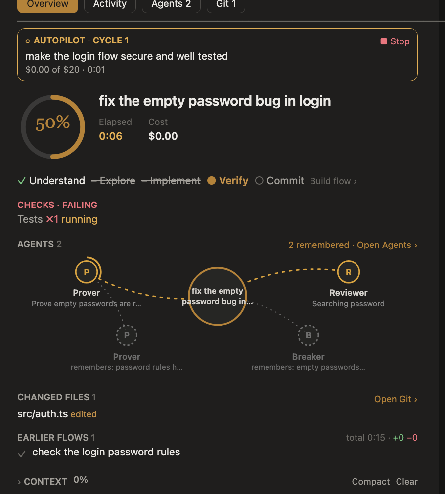

# Overview tab

What the session is doing, at a glance, in one column. Every section opens with the same small capitalised heading,
with an arrow only where it folds.

*A preview drawn from the desktop pane; the app's own spacing differs slightly.*

## From top to bottom

- **Needs you**: the attention card, for a question Claude is waiting on or a commit Cockpit proposes (Commit, Skip).
- **Autopilot**, once one has started and until you clear it (×): its cycle, the milestones ticked, the spend and the time, with ■ Stop and ▶ Resume.
  See [Autopilot](autopilot.md).
- **The current flow**: a progress ring, the task, the goal while one stands (`/goal`), the cost and, once a turn ends, how long it took (while it runs, the
  header's badge counts it), then the
  step chips with the flow they follow; pressing the flow's name opens the flow picker. See [Flows](flows.md).
- **Checks**, red while something fails: the current flow's last failed or refused tool call, and the testers'
  latest count with the first failing case.
- **Agents**, as a neural view: the task in the middle; above it every agent at work on it, Claude's and Cockpit's,
  joined by a line a signal runs along while it works, its ring filling with its own task list; below it, faint, the
  runs remembered from similar earlier tasks, each joined to the agent of its kind at work now; a tester joined to the
  agent whose work it tests. Hovering a node says what it is doing or found. In a terminal each agent is a tracker
  (a bar, done of all, the task it is on) and each memory a line. Its heading counts what finished this flow and
  what is remembered, with **Open Agents ›**. See [Agents](agents.md).
- **Changed files**: the first five, each with its kind beside it and its +/−, and Open Git.
- **Earlier flows**: the three newest (pressing one opens its details), the session's total on the heading.
- **Context**: the percentage used, the bar, **Compact** (keeps a summary, as `/compact`) and **Clear** (starts the
  conversation afresh, as `/clear`, after you confirm); the tokens by kind are folded.
- **Decisions**: one line each, the question and what came of it; the judges' mode and rules are folded. See
  [Judges](judges.md).
- **Earlier sessions**, folded.

## Around the prompt and in the chat

- **Above the prompt**: Progress and Context bars; click either to open the Overview.
- **Spinner**: `✻ Editing login.ts … 1:23`. The desktop app keeps its own row and shows Cockpit's words in it.
- **Under the prompt** (terminal only): `[cockpit] ⎇ branch ↑ahead @account +add −del tests $cost mode`.
- **In the chat**: your prompts as `›` rows, Claude's replies with a `●`, and tool activity as cards (file edits,
  searches, judge votes, subagents, commits) that open the matching tab when clicked. The latest turn ends with
  `✻ Done · ready to commit … Done in m:ss`.

## Focus, colours and live figures

- **Focus** is on by default, and your choice is kept across sessions and updates. While it is on, the chat shows
  only your prompts, Claude's replies and the activity line; tool cards and "Done in" lines are hidden (errors still
  show), the band shrinks to one line, and the pane opens only when you ask with `/cockpit`. Switch it with **◉ Focus**
  on the band or `/cockpit focus [on|off]`.
- **Colours**: the **Auto** theme (the default) uses Claude Code's own theme colours, so it follows your light or dark
  theme, with a gold accent; the status colours (green, red, amber) are the theme's too. Paper, White, Black, Solarized and Nord can be picked by hand (the dots in the pane's
  header, or `/cockpit theme <name>`).
- **Live figures**: timers, bars and the context window redraw every second while work runs. While the pane is shown,
  the repository and usage are read again every 15 seconds, so a commit made in a terminal shows up without a turn.
- **Drawing**: where the surface draws SVG (the desktop app, the editor extension, mobile), the ring, the maps and the
  icons are SVG; in a terminal they are drawn with characters.

[All docs](README.md) · [Project README](../README.md)
