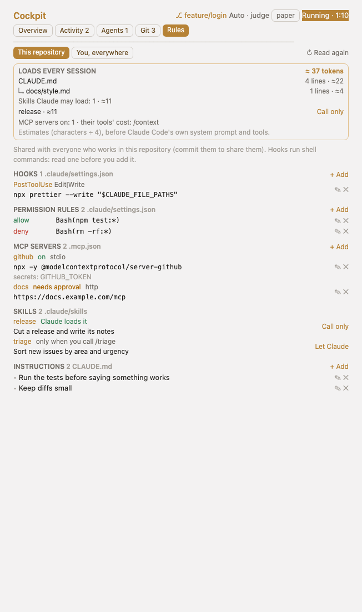

# Rules tab

The Rules tab shows the hooks, permission rules and instructions Claude Code follows, for **this repository** (`.claude/settings.json` and `CLAUDE.md`) or **you, everywhere** (`~/.claude/settings.json` and `~/.claude/CLAUDE.md`). Hooks with their event, matcher and command; permission rules as allow, ask or deny; instructions as the bullet lines of `CLAUDE.md`. Each row has ✎ to edit it in place and ✕ to delete it (after you confirm), each section **+ Add**. Every change reads the file again first and writes it back with the rest of it kept (a row that moved meanwhile is left alone); a settings file that is not valid JSON is shown read-only with the error, never overwritten. Hooks run shell commands: read one before you add it.

## MCP servers

The servers Claude Code would start here, each with its name, its kind (stdio, http, sse), what it runs (the command
and its arguments, or the URL) and whether it runs: **on**, **off** (switched off with `/mcp`, or listed in
`disabledMcpjsonServers`), **needs approval** (a project server Claude Code will ask about before its first start;
`.claude/settings.local.json`, where Claude Code keeps your answers, is read too), or **hidden** by a server of the
same name in a nearer scope (local wins over project, project over user).

- **This repository** shows the project's servers from `.mcp.json` (shared with everyone who works here), with ✎, ✕
  (after you confirm) and **+ Add** (a name, and a command with its arguments or a URL), and this project's own
  servers from `~/.claude.json`, marked *local, only you*, read only.
- **You, everywhere** shows your servers from the top of `~/.claude.json`, read only.
- `~/.claude.json` is Claude Code's own state file: Cockpit reads it and never writes it; change those servers with
  `claude mcp` or `/mcp`.
- A server's `env` and `headers` usually hold tokens: the tab shows their names (`secrets: GITHUB_TOKEN`), never their
  values, and an edit keeps them as they are in the file. Add them to `.mcp.json` by hand. Tokens in what a server runs
  are masked too (`•••`): a URL's login and query values, `KEY=value`, the word after `--token`, `--api-key` or
  `--header`, and strings shaped like known tokens. Such a server can be renamed or deleted here; what it runs is
  changed in `.mcp.json` by hand, so a masked value is never written back.
- A rename keeps what a server runs exactly, and its place in the file. Names are letters, digits, `_` and `-`, as
  Claude Code takes them.
- `.mcp.json` is read again before each change and written back with the rest of it kept; one that is not valid JSON
  is shown read-only with the error, never overwritten.

## Skills

The skills in `.claude/skills` (**This repository**) or `~/.claude/skills` (**You, everywhere**): each folder with a
`SKILL.md`, by the name and description in its frontmatter, and whether **Claude loads it** by itself (its
description sits in every session's context so Claude can pick it) or it runs **only when you call /name**.

- **Call only** adds `disable-model-invocation: true` to the frontmatter; **Let Claude** takes the line out again.
  Nothing else in the file changes, and switching back leaves it exactly as it was (line endings too).
- The `SKILL.md` is read again before each switch; one whose frontmatter cannot be read (no `---` at its top, never
  closed, or a line that is not a `key: value`, an indented line under one, a comment or blank) is shown read only with
  why, never written. Every copy of the key is changed together, and each line keeps its own line ending.
- Skills a plugin brings are not listed here; the Agents tab shows the agents plugins add.

[All docs](README.md) · [Project README](../README.md)
